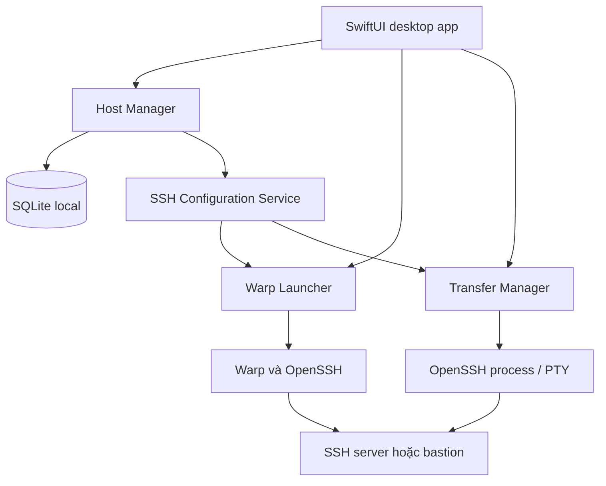
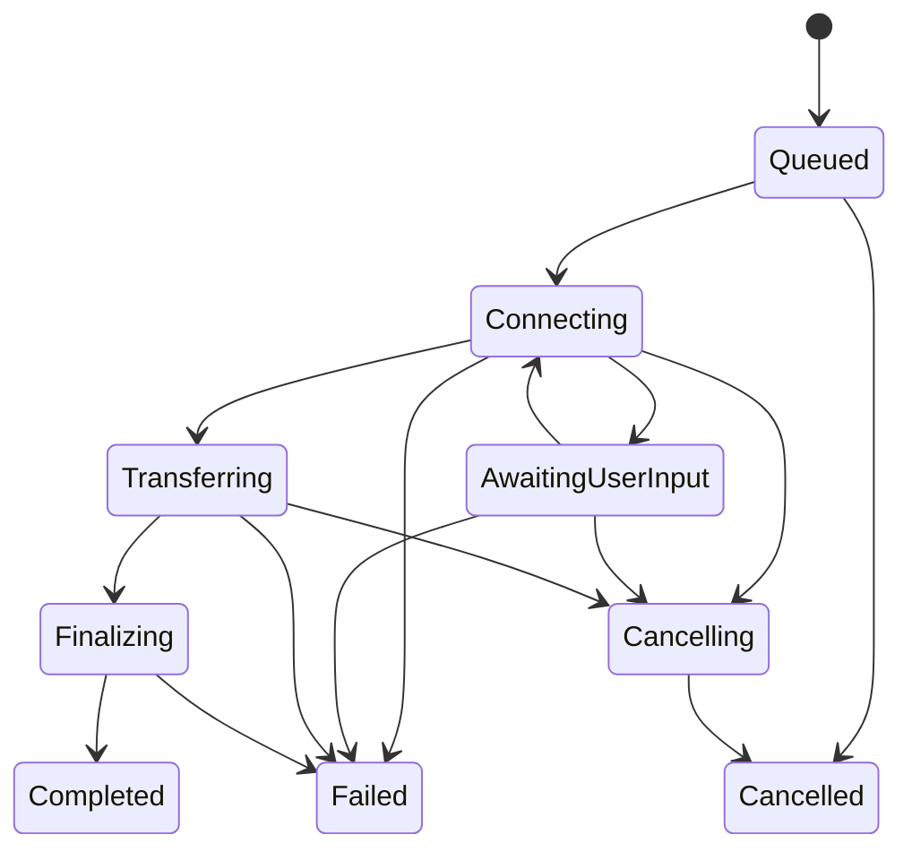

# PROMPT CHO CLAUDE CODE — SSH DESK CHO MACOS

> Cách dùng: đính kèm toàn bộ file này vào Claude Code trong thư mục dự án trên Mac. Đây là yêu cầu triển khai sản phẩm, không chỉ là yêu cầu tư vấn kiến trúc.

## 1. Vai trò và mục tiêu

Bạn là kỹ sư macOS senior. Hãy thiết kế chi tiết, viết code, build và kiểm tra một ứng dụng desktop macOS native tên **SSH Desk**, phục vụ **duy nhất tôi**.

Tôi là DevOps engineer, sử dụng Mac và Warp. Tôi muốn khai báo máy chủ một lần, sau đó:

1. Tìm và chọn máy chủ nhanh.
2. Bấm **Mở Warp** để mở terminal SSH tới máy đó.
3. Bấm **Tải về** để kéo file/thư mục từ máy chủ về Mac.
4. Bấm **Tải lên** để chuyển file/thư mục từ Mac lên máy chủ.
5. Dùng được máy chủ nằm sau bastion/jump host.

Tôi tự dùng app này. Ưu tiên thao tác đơn giản, tính ổn định, dùng được với cấu hình SSH hiện tại và dễ bảo trì.

**Hãy triển khai MVP chạy thật.** Không chỉ trả lời kế hoạch; không thay chức năng kết nối hoặc truyền file bằng dữ liệu giả. Nếu môi trường chưa thể build/test macOS, hoàn thành phần có thể làm, ghi rõ giới hạn và cung cấp cách xác minh trên Mac; không tuyên bố đã build hay chạy thử khi chưa thực hiện.

## 2. Phạm vi đã chốt

### Có trong MVP

- App desktop native macOS, giao diện tiếng Việt.
- Quản lý hồ sơ máy chủ: thêm, sửa, xóa, tìm kiếm, nhóm dự án, môi trường và yêu thích.
- Hỗ trợ hồ sơ nhập thủ công và hồ sơ tham chiếu alias trong SSH config hiện có.
- SSH key, SSH agent và xác thực tương tác khi cần password/passphrase/MFA.
- Kết nối qua bastion bằng cơ chế OpenSSH.
- Mở SSH trong ứng dụng Warp đã cài trên Mac.
- Upload/download theo đường dẫn, có chọn file/thư mục local.
- Hàng đợi truyền file, hủy tác vụ, thử lại và lịch sử.
- Import/export metadata hồ sơ để sao lưu cá nhân.
- Lưu dữ liệu trên Mac; app hoạt động với máy chủ nội bộ khi không có Internet.

### Để sau MVP

- File explorer hai cột local/remote, duyệt và kéo thả thư mục remote.
- Đồng bộ thư mục, resume, đồng bộ hai chiều, sửa file remote.
- Chuyển file trực tiếp giữa hai server.
- Quản lý SSH tunnel.
- Lưu và thực thi script quản trị server.
- Tích hợp thêm terminal khác.

### Không xây trong sản phẩm này

- Website, web server localhost, backend cloud, Docker runtime cho app.
- Đăng ký/đăng nhập, tenant, phân quyền nhiều người, billing, cộng tác nhóm.
- Terminal SSH tự viết hoặc nhúng một terminal thay cho Warp.
- AI, analytics/telemetry, cập nhật tự động bắt buộc, đồng bộ cloud mặc định.
- Network Extension, kernel extension hoặc yêu cầu quyền root cho hoạt động bình thường.

## 3. Cách bạn thực hiện công việc

1. Đọc `AGENTS.md` và kiểm tra repository trước khi sửa. Giữ nguyên các thay đổi không thuộc nhiệm vụ này.
2. Kiểm tra hệ điều hành, kiến trúc CPU, Swift toolchain/macOS SDK, OpenSSH và Warp hiện có. Không đoán phiên bản được hỗ trợ.
3. Đưa ra kế hoạch ngắn rồi thực hiện. Tự quyết định các chi tiết thông thường theo tài liệu này; chỉ hỏi khi có thiếu sót thực sự ngăn việc triển khai hoặc cần thao tác có ảnh hưởng ngoài dự án.
4. Kiểm chứng đường đi quan trọng trước: app mở được Warp bằng cấu hình SSH; worker truyền được một file qua OpenSSH.
5. Sau đó hoàn thiện lưu trữ, UI, hàng đợi và xử lý lỗi.
6. Build/test các phần quan trọng. Phân biệt rõ kiểm tra tự động, kiểm tra thủ công và các trường hợp chưa có môi trường xác minh.
7. Không kết nối server thật, bật Remote Login trên Mac, thay đổi cấu hình bảo mật hệ thống hoặc cài agent lên máy đích chỉ để tự tạo môi trường kiểm thử nếu chưa có yêu cầu rõ ràng.
8. Không commit/push hay phát hành ra dịch vụ bên ngoài nếu không được yêu cầu. Giao sản phẩm và hướng dẫn build local.

## 4. Lựa chọn công nghệ

- **Swift + SwiftUI**, bổ sung AppKit ở những chỗ cần như chọn file, mở URL bằng ứng dụng hệ thống và quản lý vòng đời cửa sổ.
- Mục tiêu ban đầu: **macOS 14 trở lên**, build cho kiến trúc Mac đang phát triển. Xác minh API với deployment target thực tế.
- Swift Concurrency cho công việc nền; UI cập nhật trên main actor; I/O, SQLite và tiến trình SSH không chặn giao diện.
- **SQLite** để lưu hồ sơ, cài đặt và lịch sử. Có thể sử dụng SQLite3 của hệ thống để giữ số dependency ít.
- **macOS Keychain** cho credential nếu người dùng chọn lưu. SSH agent/file key vẫn là lựa chọn chính cho kết nối thuận tiện.
- **OpenSSH có sẵn trên Mac** cho SSH và truyền file. Hãy kiểm tra version thực tế và khả năng cần dùng.
- **Warp Tab Config + URI scheme** cho mở terminal.
- Ưu tiên Swift Package có thể mở trong Xcode, kèm script build thành `.app`. Nếu repository đã có cấu trúc Xcode hợp lý thì sử dụng cấu trúc đó. Chọn một luồng build chính, tài liệu hóa rõ ràng và tránh yêu cầu công cụ tạo project bên ngoài khi không cần.
- Phát hành để chạy cá nhân ngoài Mac App Store; không bật App Sandbox máy móc rồi đánh đổi việc truy cập SSH config, key và tiến trình hệ thống bằng các workaround không rõ ràng.
- Không yêu cầu tài khoản Apple Developer trả phí chỉ để build và dùng local. Nếu có ký app local/ad-hoc, mô tả đúng phạm vi; không gọi đó là app đã được notarize.

## 5. Mô hình thành phần

Tách trách nhiệm tối thiểu:

| Module | Trách nhiệm |
|---|---|
| Presentation | SwiftUI views, view models/state, validation và thông báo |
| HostRepository | CRUD, tìm kiếm, favorite, nhóm, import/export metadata |
| SSHConfigurationService | Xác định target, tạo config do app quản lý, tham chiếu config hiện có |
| WarpLauncher | Sinh Tab Config và mở deep link, trả trạng thái yêu cầu mở |
| OpenSSHProcessRunner | Khởi chạy executable bằng argv, điều khiển PTY và vòng đời process |
| TransferManager | Queue, state machine, auth callbacks, progress, cancellation, retry |
| CredentialStore | Keychain; chỉ trả credential cho tác vụ xác thực tương ứng |
| TransferRepository | Lịch sử có giới hạn; không lưu secret hoặc toàn bộ transcript |

Giữ kiến trúc đủ nhỏ cho một ứng dụng cá nhân. Không thêm microservice, plugin framework hoặc hệ thống event phân tán.

## 6. Mô hình dữ liệu

### HostProfile

- `id`: UUID ổn định, dùng cho tên config do app tạo.
- `displayName`.
- `project`.
- `environment`: DEV/UAT/STG/PROD/OTHER.
- `tags`, `notes`, `isFavorite`.
- `connectionMode`: `managed` hoặc `existingSSHConfigAlias`.
- Với `managed`: hostname/IP, port, username, phương thức xác thực, đường dẫn key nếu có, jump host tùy chọn.
- Với `existingSSHConfigAlias`: đường dẫn SSH config nguồn được cho phép và alias gốc; không giả định đã biết toàn bộ cấu hình hiệu lực.
- `jumpHostID`: tham chiếu hồ sơ khác khi app quản lý bastion; kiểm tra tham chiếu vòng và hồ sơ bị xóa.
- `credentialReference`: tham chiếu Keychain khi có, không phải password.
- `remoteBookmarks`: tên và đường dẫn thư mục remote.
- `defaultLocalDirectory`, `defaultRemoteDirectory`.
- `createdAt`, `updatedAt`, `lastLaunchRequestedAt`.

### TransferJob

- `id`, `hostID`, bản chụp tên máy và target hiển thị tại thời điểm tạo tác vụ.
- Chiều `upload` hoặc `download`.
- Đường dẫn nguồn, đích, loại file/thư mục và lựa chọn ghi đè đã được xác nhận.
- State, thời gian tạo/bắt đầu/kết thúc.
- Bytes/progress/speed nếu thu thập được; cho phép giá trị chưa biết.
- Kết quả, exit status, nguyên nhân lỗi ngắn gọn đã loại bỏ dữ liệu nhạy cảm.
- Tham chiếu tới lần thử trước khi retry.
- Không lưu password, passphrase, OTP hay raw PTY transcript.

Tác vụ đang chạy sử dụng cấu hình đã xác định lúc bắt đầu; việc sửa hồ sơ giữa chừng không âm thầm đổi đích của tác vụ. Hàng đợi cần kiểm tra lại hồ sơ trước khi bắt đầu.

### Settings

- Thư mục local mặc định, giới hạn lịch sử, chính sách khi đóng cửa sổ.
- Cách mở Warp: tab hoặc cửa sổ mới.
- Số tác vụ đồng thời: mặc định **1** cho MVP.
- Đường dẫn tới SSH config người dùng và vùng cấu hình riêng của app.
- Phiên bản schema phục vụ migration.

Lưu SQLite trong Application Support của app. Thư mục chứa cấu hình/metadata nhạy cảm chỉ cho user hiện tại truy cập. Khi đọc database lỗi, báo lỗi và giữ nguyên dữ liệu để khôi phục; không âm thầm xóa hoặc tạo dữ liệu rỗng đè lên.

## 7. Một nguồn cấu hình SSH dùng chung

Mục tiêu: **một hồ sơ cho ra cùng target/auth/jump host khi mở Warp và khi truyền file**.

### Hồ sơ app quản lý

- Sinh alias nội bộ ổn định từ UUID, ví dụ `sshdesk-<id>`; tên hiển thị có thể đổi mà không làm hỏng tham chiếu.
- Sinh cấu hình trong file riêng của SSH Desk.
- Không ghi đè hoặc viết lại toàn bộ `~/.ssh/config`.
- Cả lệnh SSH của Warp và worker truyền file tham chiếu cùng file cấu hình qua tùy chọn OpenSSH phù hợp.
- Cho phép file riêng tham chiếu config người dùng bằng cơ chế `Include` để kế thừa alias bastion và thiết lập có sẵn.
- Chú ý thứ tự ưu tiên: OpenSSH thường lấy giá trị đầu tiên cho một tùy chọn. Các `Host` do app quản lý phải được tổ chức đúng; reset ngữ cảnh `Host *` trước khi Include chung để tránh Include chỉ hiệu lực trong Host cuối cùng. Kiểm chứng hành vi thực tế, không giả định từ parser tự viết.
- Nếu cần snapshot riêng cho job, kiểm tra cả kết nối bastion sử dụng đúng config. Không để job chạy nhầm credential vì đường dẫn config không được truyền đến kết nối trung gian.

### Import SSH config

- Hiển thị alias `Host` cụ thể để người dùng chọn import.
- Pattern như `Host *` hoặc `Host *.internal` không tự biến thành một máy chủ.
- Giữ alias nhập vào dưới dạng tham chiếu. Không flatten rồi ghi đè `Include`, `Match`, `ProxyCommand`, `ProxyJump` hoặc các thiết lập phức tạp.
- Có thể đọc Include để tìm alias với giới hạn độ sâu và phát hiện vòng lặp. Nếu không resolve được, hiển thị rõ phần chưa đọc.
- Việc import chỉ đọc dữ liệu; không tự chạy command trong file. Đặc biệt, `ssh -G` có thể xử lý `Match exec`, nên không chạy nó nền chỉ vì vừa chọn import.
- Việc kiểm tra/kết nối thực tế mới giao cho OpenSSH xử lý cấu hình đã được người dùng chọn.
- Có alias conflict thì báo rõ hoặc dùng namespace nội bộ phù hợp; không đổi ý nghĩa alias hiện có âm thầm.

## 8. Luồng mở SSH trong Warp

1. Người dùng chọn máy → bấm **Mở Warp**.
2. Kiểm tra dữ liệu hồ sơ và khả năng mở Warp.
3. Chuẩn bị cấu hình SSH và Tab Config chỉ thuộc app quản lý.
4. Tab Config chứa **một** startup command SSH dùng alias và file config đã xác định.
5. Gọi URI dạng `warp://tab_config/<file_stem>`; tùy chọn mở cửa sổ mới nếu được cấu hình.
6. Warp thực hiện SSH, xử lý câu hỏi host key, password, passphrase và MFA trong terminal của nó.
7. App ghi nhận **đã yêu cầu mở Warp**, không tự ghi là đã đăng nhập thành công.

Các yêu cầu bắt buộc:

- Kiểm tra tài liệu/phiên bản Warp đang cài trước khi chốt adapter. Tài liệu đã tham khảo hỗ trợ Tab Config trong `~/.warp/tab_configs/` và URI `warp://tab_config/<name>`.
- URI không thực thi shell command tùy ý và không trả exit code của phiên SSH. Không tự sáng tạo scheme kiểu `warp://ssh?...` hoặc query `command=`.
- Chỉ tạo/cập nhật file có namespace do SSH Desk sở hữu, không ghi đè Tab Config của người dùng.
- Sinh TOML bằng cách escape đúng; tên hồ sơ và ghi chú không được biến thành code.
- Startup command là phần phải qua shell: dùng executable cố định, quote đối số đúng với shell đã chọn, không nối chuỗi thô từ hostname/username/path.
- Nếu cần ổn định quy tắc quoting, chọn shell `/bin/zsh` cho Tab Config và kiểm tra schema Warp hỗ trợ; không giả định shell mặc định luôn là POSIX shell.
- Không thêm các command nằm sau lệnh SSH tương tác rồi kỳ vọng chúng chạy trên server.
- Không đưa password/key material vào URI, command, TOML hay clipboard.
- Nếu Warp không có hoặc phiên bản không hỗ trợ cách mở này, thông báo đúng và cho **Copy lệnh SSH** làm fallback. Có thể thêm adapter Launch Configuration legacy nếu đã kiểm chứng, nhưng không hạ chất lượng đường chính để dựa vào API không được tài liệu hóa.
- Không tự động hóa gõ bàn phím vào Warp bằng Accessibility để chèn password.
- Đóng SSH Desk không đóng phiên Warp đã mở.

## 9. Luồng truyền file

### Tải về

1. Chọn host → **Tải về**.
2. Nhập đường dẫn remote hoặc chọn một bookmark làm điểm bắt đầu.
3. Chọn file hay thư mục và nơi lưu trên Mac bằng native picker.
4. Hiển thị rõ host, username, chiều truyền, nguồn và đích.
5. Xử lý tên trùng/ghi đè trước khi bắt đầu.
6. Đưa vào queue; worker xác thực nếu cần rồi thực hiện truyền.
7. Cập nhật trạng thái; hoàn tất thì cho **Mở trong Finder**.

### Tải lên

1. Chọn host → **Tải lên**.
2. Chọn file/thư mục local.
3. Nhập đường dẫn remote đích; hiển thị tên cuối cùng dự kiến.
4. Xác nhận đích và chính sách ghi đè.
5. Worker thực hiện truyền, báo kết quả và lưu lịch sử.

### Backend truyền file

- Dùng OpenSSH `scp` chạy ở chế độ SFTP mặc định, hoặc OpenSSH `sftp` nếu cần thao tác kiểm tra/chuyển file phù hợp hơn. Chọn rõ backend cho từng thao tác; không tạo hai implementation nửa vời.
- Kiểm tra phiên bản OpenSSH và chế độ thực tế trên Mac. Không tự thêm `-O` để quay về giao thức SCP legacy.
- Khởi chạy process bằng executable và argv, không qua `sh -c` với input người dùng.
- Dùng PTY cho tiến trình cần xác thực tương tác hoặc progress của OpenSSH. Quản lý stdin/output, controlling terminal và vòng đời process đúng trên macOS.
- Chuyển prompt xác thực sang UI của app; hỗ trợ password, passphrase và keyboard-interactive/MFA. Có fallback hiển thị prompt đã làm sạch thay vì chỉ hardcode duy nhất chuỗi `Password:`.
- OTP không lưu. Password/passphrase không được ghi log, truyền qua argv hay lưu vào environment.
- Dùng SSH agent của phiên người dùng nếu có. Kiểm tra riêng trường hợp app mở từ Finder khác môi trường khi mở từ terminal.
- Giữ kiểm tra `known_hosts`; host mới cần người dùng xem fingerprint và xác nhận, host key thay đổi phải dừng và báo rõ. Không dùng `StrictHostKeyChecking=no` hoặc xóa `known_hosts` tự động.
- Không tự đẩy credential đã lưu vào một challenge khác chủ thể/host một cách mù quáng.
- File đích bị từ chối do quyền filesystem: báo lỗi đúng. Không tự thêm `sudo`, đổi owner, chmod hay retry bằng root.

### Đường dẫn, ghi đè và dữ liệu dở dang

- Hỗ trợ các đường dẫn thông thường có khoảng trắng và Unicode.
- Phân biệt escaping cho argv, shell của Warp và cú pháp đường dẫn/glob của SCP/SFTP. Một hàm shell-quote không giải quyết được cả ba.
- Với thao tác người dùng chọn một file cụ thể, không vô tình mở rộng `*`, `?`, `[]` thành nhiều file. Có test cho literal paths; nếu backend chưa hỗ trợ một trường hợp, từ chối rõ thay vì âm thầm truyền nhầm.
- Kiểm tra tên file bắt đầu bằng dấu `-`, dấu `:`, dấu nháy, IPv6, ký tự điều khiển và newline. Dùng đường dẫn local tuyệt đối khi cần để tránh bị hiểu thành remote spec.
- Không tự ghi đè dữ liệu chỉ vì CLI mặc định cho phép. Nếu có tên trùng, cung cấp **ghi đè / đổi tên / bỏ qua** phù hợp với thao tác.
- Nếu backend chưa thể kiểm tra tồn tại hoặc bảo đảm không ghi đè ở remote, phải nói rõ trước khi người dùng xác nhận đích/ghi đè; không gắn nhãn “không ghi đè” cho một hành vi backend không bảo đảm. Có thể đề xuất tên đích duy nhất.
- Không coi kiểm tra tồn tại trước upload là bảo đảm nguyên tử khi có tiến trình khác đang ghi đồng thời.
- Download nên dùng file tạm có định danh job rồi finalize tại local khi thành công nếu phù hợp. Lỗi/hủy phải báo còn file tạm nào; chỉ dọn file tạm do app tạo, không xóa file có sẵn của người dùng.
- Không hứa upload nguyên tử hoặc resume cho mọi server. Nếu dùng staging/rename thì kiểm chứng semantics; ghi rõ những gì đã hỗ trợ.
- Khi truyền thư mục, mô tả và kiểm tra hành vi với symlink; không âm thầm đi theo liên kết ra ngoài cây thư mục người dùng chọn.

### Tiến độ và trạng thái

- Khi không xác định được tổng dung lượng, dùng indeterminate progress. Không chế phần trăm hoặc ETA.
- Chỉ báo Completed sau khi process thành công và bước hoàn tất local cần thiết đã xong; không dựa riêng vào dòng `100%`.
- Nếu user đã hủy, exit code do signal phải được nhận diện là Cancelled thay vì lỗi ngẫu nhiên.
- Khi một job chờ input, UI vẫn phản hồi và cho hủy.
- Cancellation chỉ tác động process/process group do job sở hữu. Không `killall ssh`, không đóng phiên Warp hay SSH khác của người dùng.
- Có thời gian chờ kết nối hợp lý; không tự coi thời gian truyền file lớn là timeout kết nối.
- Retry tạo một lần thử mới và giữ kết quả cũ. Không tự resume vào file khác chỉ vì tên giống nhau.
- Sau crash hoặc restart app, các job từng chạy chuyển thành **Bị gián đoạn**; không tự tiếp tục ghi lên server.

## 10. Giao diện và trải nghiệm

Thiết kế theo phong cách native macOS: gọn, rõ, ưu tiên thao tác bàn phím và dark/light mode của hệ thống. Dùng SF Symbols khi phù hợp. Không làm dashboard với nhiều biểu đồ hoặc số liệu không phục vụ tác vụ.

### Khu vực Máy chủ

- Sidebar: Tất cả, Yêu thích, nhóm dự án; thêm lối vào Truyền file, Lịch sử, Cài đặt.
- Ô tìm kiếm theo tên, host, username và tag.
- Danh sách hiển thị tên, địa chỉ, môi trường và favorite.
- Chọn một máy hiện chi tiết cùng ba nút chính: **Mở Warp**, **Tải về**, **Tải lên**.
- PROD có nhãn/màu dễ nhận biết; luôn hiển thị target ở form truyền file.
- Có shortcut hợp lý như tạo hồ sơ mới và focus tìm kiếm; không chiếm shortcut hệ thống vô lý.
- Empty state hướng dẫn thêm máy hoặc import SSH config. Không tạo sẵn host giả vào dữ liệu thật.

### Form hồ sơ

- Bắt đầu từ trường cần thiết; bastion và các tùy chọn khác nằm trong phần nâng cao.
- Với imported alias, hiển thị rõ nguồn cấu hình, không biến form thành bản sao không chính xác của cấu hình hiệu lực.
- Chọn file key bằng file picker; không hiển thị nội dung private key.
- Trường password có tùy chọn lưu Keychain rõ ràng; mặc định có thể nhập khi kết nối.
- Không dùng trạng thái “online” chỉ vì hồ sơ tồn tại hoặc Warp đã được mở.
- Kiểm tra kết nối là thao tác chủ động, không ping/SSH tất cả host liên tục.

### Queue và lịch sử

- Job thể hiện chiều truyền, máy, nguồn, đích, trạng thái, thời gian và tiến độ khi có.
- Nút Hủy / Thử lại / Mở trong Finder phù hợp với trạng thái.
- History có giới hạn lưu trữ và nút xóa; xóa lịch sử không xóa file được truyền.
- Khi người dùng thoát hẳn app trong lúc truyền: cho chọn tiếp tục chạy app hoặc hủy tác vụ rồi thoát. Không tuyên bố truyền vẫn tiếp tục sau khi process app/worker đã kết thúc.

## 11. Bảo vệ dữ liệu và độ tin cậy

Các yêu cầu này phục vụ trực tiếp app cá nhân có credential và quyền ghi file; không xây thêm quy trình phê duyệt doanh nghiệp.

- Database chỉ có metadata và tham chiếu Keychain.
- Không log bí mật, không đưa secret vào command line, export, clipboard hoặc báo lỗi.
- Export mặc định không chứa private key/password/passphrase/OTP. Import có validation, phiên bản schema và báo conflict.
- Alias, config fields, TOML và đường dẫn đều cần xử lý chống command/config injection, bao gồm newline.
- Mọi file cấu hình do app sinh ghi atomically và có quyền truy cập phù hợp.
- Không sửa config của Warp hoặc SSH ngoài những file app sở hữu, trừ một thao tác rõ ràng được người dùng yêu cầu.
- Lỗi từ server được coi là dữ liệu, không được diễn giải thành command cần chạy.
- Đường dẫn/key/notes của user có thể nhạy cảm: tránh ghi toàn bộ vào log hệ thống; diagnostics xuất ra phải có chủ đích và được làm sạch.
- Không tự bật agent forwarding; ProxyJump không đòi hỏi phải bật forwarding.
- Không triển khai remote agent, không yêu cầu máy đích truy cập Internet để mở SSH cơ bản.

## 12. Kế hoạch thực hiện

### Bước A — Kiểm chứng tích hợp

- Tạo skeleton app có thể mở được trên Mac.
- Kiểm chứng Tab Config và URI của Warp trên phiên bản đang cài.
- Kiểm chứng cấu hình OpenSSH dùng chung và target qua bastion trong môi trường test nếu có.
- Kiểm chứng truyền một file nhỏ và xử lý lỗi xác thực.
- Ghi lại giới hạn phát hiện được trước khi hoàn thiện UI.

### Bước B — Hồ sơ máy chủ

- CRUD, validation, SQLite, import alias, nhóm, favorite và search.
- Sinh config riêng, Warp adapter và fallback copy command.

### Bước C — Truyền file

- Form upload/download, worker chạy nền, PTY/auth UI, queue/state machine.
- Hủy, retry, overwrite handling, lỗi và lịch sử.

### Bước D — Hoàn thiện bản dùng cá nhân

- Vòng đời app, Keychain, import/export, empty states, dark/light mode.
- Test, build `.app`, tài liệu cài/chạy và danh sách giới hạn thực tế.

Đây là thứ tự triển khai trong cùng nhiệm vụ. Không dừng sau Bước A hoặc trả scaffold rồi tuyên bố hoàn thành MVP.

## 13. Kiểm thử có ý nghĩa

Ưu tiên test các phần có khả năng làm kết nối sai, lộ credential hoặc ghi nhầm file:

1. Sinh và tham chiếu SSH config: managed/imported alias, Include, Host wildcard, bastion và thứ tự ưu tiên.
2. Quoting và validation: khoảng trắng, Unicode, dấu nháy, dấu `$`, dấu backtick, newline, leading dash, dấu `:` và glob characters. Không có input nào trở thành một command bổ sung.
3. Sinh TOML Warp hợp lệ; URI dùng đúng file stem; không ghi đè file ngoài namespace của app.
4. Queue/state machine: hủy trước khi chạy, hủy khi xác thực, hủy lúc truyền, lỗi finalize, retry và recovery sau crash.
5. Password/passphrase/OTP không xuất hiện trong argv, database, logs hoặc export.
6. Import không sửa file nguồn và không tự chạy `Match exec`.
7. Ghi đè/đổi tên/bỏ qua, file dở dang, lỗi thiếu quyền và hết dung lượng nếu có môi trường kiểm tra.

Integration test trên server test được cho phép:

- SSH key/agent và password.
- Bastion/ProxyJump.
- File có khoảng trắng/Unicode, file lớn hơn một gói nhỏ, upload và download kiểm tra nội dung/hash.
- Host không tồn tại, port đóng, sai credential, remote path thiếu, host key mismatch.
- Cancel không làm đóng một phiên SSH/Warp không liên quan.
- Nếu không có MFA hoặc môi trường cụ thể, đánh dấu chưa xác minh; test mô phỏng prompt không được trình bày là test MFA end-to-end.

Không kết nối production để nghiệm thu. Không viết test chỉ kiểm tra hardcoded text trên UI. Khi các rủi ro chính đã được kiểm chứng thì hoàn tất bàn giao, tránh kéo dài bằng test không phục vụ yêu cầu.

## 14. Tiêu chí nghiệm thu MVP

- Build được `.app` trên Mac mục tiêu và mở từ Finder.
- Dữ liệu hồ sơ được giữ sau khi đóng/mở app.
- Tạo một hồ sơ, sửa tên, tìm kiếm và đánh dấu yêu thích hoạt động.
- Import một alias có sẵn mà không thay đổi ý nghĩa config gốc.
- Bấm Mở Warp sinh đúng cấu hình, mở đúng target; app không báo đăng nhập thành công chỉ từ việc mở URI.
- Key/agent và bastion dùng thống nhất ở cả mở Warp và truyền file.
- Upload và download thật; xác minh file nhận được đúng nội dung.
- Password/passphrase/MFA có đường tương tác rõ ràng; các nhánh chưa kiểm thử được được ghi rõ.
- UI phản hồi trong khi truyền, có hủy và thử lại.
- Tác vụ chỉ báo thành công sau kết quả thực; file trùng và dữ liệu dở dang được xử lý theo chính sách công khai.
- Không có credential trong SQLite/export/logs.
- App hoạt động với server trong LAN/VPN mà không phụ thuộc dịch vụ cloud của SSH Desk.

## 15. Bàn giao

Tạo trong repository:

- Source code được tổ chức rõ ràng.
- Cấu hình build và script build `.app` phù hợp.
- `README.md` tiếng Việt: yêu cầu môi trường, build/chạy, thêm host, import SSH config, mở Warp, truyền file, vị trí dữ liệu và sao lưu.
- `ARCHITECTURE.md`: sơ đồ module, dữ liệu, SSH config resolution, process/auth flow và state machine.
- `TESTING.md`: lệnh test, kết quả đã thực hiện, ma trận thử nghiệm và phần chưa xác minh.
- `KNOWN_LIMITATIONS.md`: giới hạn thực tế, bao gồm fallback Warp, progress, auth và các trường hợp đường dẫn chưa hỗ trợ nếu có.
- Nếu môi trường build được, đặt bundle `.app` vào thư mục output có tên rõ ràng. Không đưa key, credential, host thật hoặc file thử nghiệm nhạy cảm vào artifact.

Khi kết thúc, trả lời ngắn gọn: đã hoàn thành gì, cách chạy, đã kiểm thử gì và điều gì còn cần người dùng kiểm tra trên Mac. Không gọi sản phẩm là production-ready nếu chưa có bằng chứng.

## 16. Tài liệu tham chiếu

Các tài liệu đã được tham khảo khi soạn yêu cầu ngày **21/10/2026**. Khi triển khai, đối chiếu lại với phiên bản thực tế trên máy, đặc biệt tính năng URI/Tab Config của Warp.

- Warp URI Scheme: https://docs.warp.dev/terminal/more-features/uri-scheme
- Warp Tab Configs: https://docs.warp.dev/terminal/windows/tab-configs
- Warp Launch Configurations (legacy, chỉ để tham khảo fallback): https://docs.warp.dev/terminal/sessions/launch-configurations
- OpenSSH client configuration: https://man.openbsd.org/ssh_config
- OpenSSH SCP: https://man.openbsd.org/scp
- OpenSSH SFTP: https://man.openbsd.org/sftp

**Bắt đầu bằng việc kiểm tra repository và môi trường, nêu kế hoạch ngắn rồi triển khai MVP theo các yêu cầu trên.**
